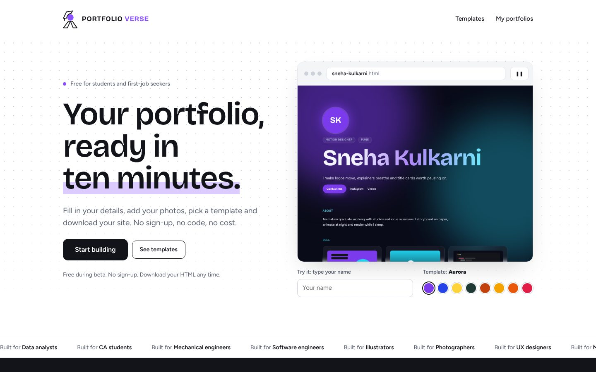
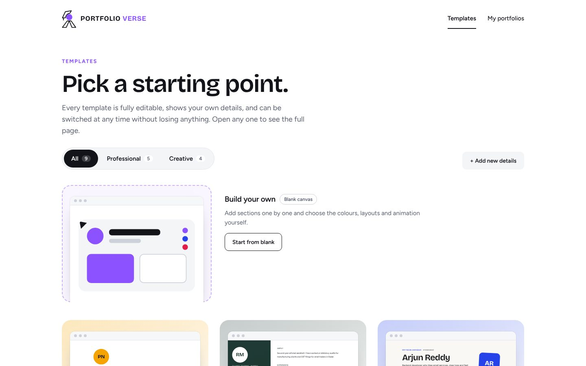
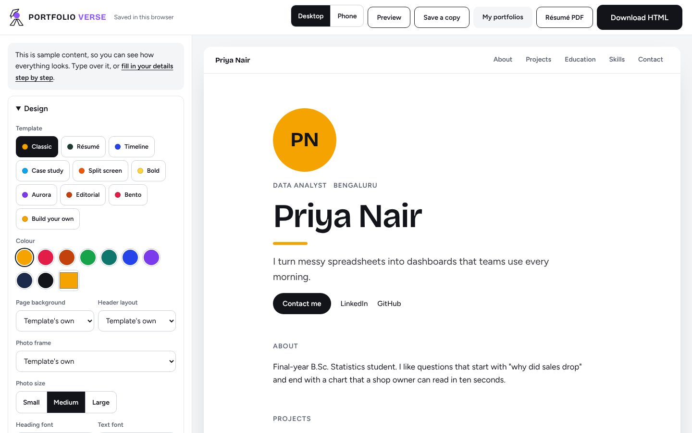
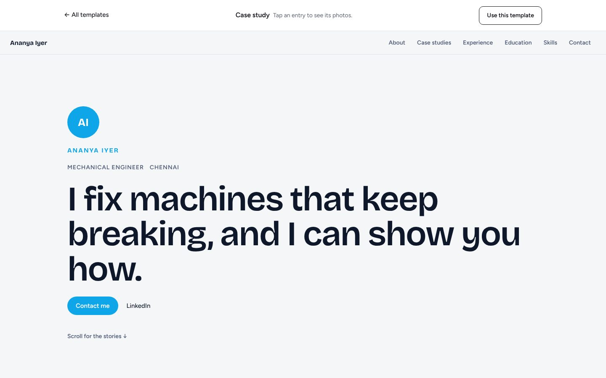
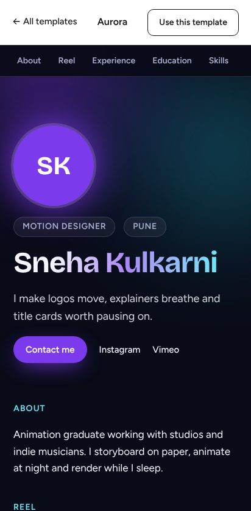

# PORTFOLIO-VERSE

**A free portfolio website builder for students and first-job seekers.** Fill in your details (or import your résumé), pick one of nine templates, tweak the design, and download your whole site as a single HTML file. No sign-up, no code, no cost.

**Live:** [portfolio-verse-tau.vercel.app](https://portfolio-verse-tau.vercel.app)



## Why I built it

Most students need a portfolio site for internship and job applications, but website builders are either paid, need an account, or produce generic pages. PORTFOLIO-VERSE works entirely in the browser:
- nothing to sign up for
- nothing to pay
- your data never leaves your device

## Features

- **9 templates, one data model:** Classic, Résumé, Timeline, Case study, Split screen, Bold, Aurora, Editorial and Bento, plus "Build your own". Your details appear in every template, so you can switch at any time without retyping.
- **Live editor:**
  - colours, fonts, backgrounds, header layouts, photo frames and scroll animations, set for the whole page or per section
  - reorder sections and entries
  - desktop and phone preview
- **Résumé import:** reads a résumé PDF in the browser and fills in the details.
- **Résumé PDF export:** generates a clean résumé from the same details.
- **Photo background removal:** a person-segmentation model running in the browser cuts you out of your photo for the contact card.
- **Photos fit their frames:** every photo fills its frame in every template, whatever its shape, and you choose which part of your own photo stays in view.
- **Interactive contact section:** a 3D character that follows the pointer, watches visitors type and cheers when a message is sent; or your photo, a design, or nothing. The message form works through the visitor's email app or straight to your inbox.
- **Details panel:** visitors tap a project or job to open a side panel (a bottom sheet on phones) with the full story and photos.
- **Section navigation:** a sticky section bar, reading progress and back-to-top in every portfolio.
- **Many portfolios per browser:** autosave, rename, copy and delete. Details and designs are independent, so any details can go in any template.
- **One-file export:** the downloaded `.html` holds the styles, photos and interactions, and works offline or on any host (GitHub Pages, Netlify, Vercel...).
- **Accessible:** keyboard-friendly, labelled controls, and every animation is turned off for people who ask for reduced motion.

| Template gallery | Editor |
| --- | --- |
|  |  |

| Case study template | On a phone |
| --- | --- |
|  |  |

## Tech stack

- **Next.js 15 (App Router), React 19, TypeScript**, deployed on **Vercel**
- **IndexedDB** for storage, so there's no database or backend
- **MediaPipe Selfie Segmenter** (WebAssembly) for background removal
- **pdf.js** to read résumés, **jsPDF** to write them
- Hand-written CSS with custom properties and container queries; no UI library

## Engineering highlights

- **No backend at all.**
  - Every feature, including machine-learning background removal and PDF parsing, runs on the user's device.
  - Running costs stay at zero, and the privacy story is simple: we never receive anyone's data.
  - The ML model and PDF engine are served by the site itself and loaded only when used (`scripts/copy-vendor.mjs`).
- **One renderer, three places.**
  - `components/PortfolioView.tsx` renders every template from one markup tree.
  - The template's interactions (`lib/runtime.ts`) are written as a self-contained function. It runs in the editor and on preview pages, and is serialised into the downloaded HTML file (`lib/exportHtml.ts`), so the exported site behaves exactly like the preview.
- **Templates as styles, not code.** Each template is a set of CSS rules over shared markup (`public/portfolio.css`), so the editor's options combine with any template.
- **Safe, versioned storage.**
  - Portfolios are saved per id in IndexedDB with transactional updates (`lib/store.ts`).
  - Older saved data is migrated on load (`normalize` in `lib/portfolio.ts`), including templates that were merged or retired.
- **Résumé parsing without AI APIs.** `lib/resumeImport.ts` rebuilds lines from pdf.js text positions, finds section headings and pulls out names, links, dates and bullet points with patterns. The user always checks the result, and the UI says so.

## Project structure

```
app/          pages: landing, /start (details form), /templates, /editor, /saved, /privacy
components/   UI: PortfolioView (templates), Editor, Fields, StartForm, ContactBlock, StepsShowcase, Intro...
lib/          portfolio.ts (data model), store.ts (IndexedDB), runtime.ts (portfolio interactions),
              exportHtml.ts, resumeImport.ts, resumePdf.ts, cutout.ts, templates.ts, samples.ts
public/       portfolio.css (all template styles, also copied into exports), logo
docs/         README screenshots
```

## Run it locally

Requires Node.js 18.18 or newer. No environment variables are needed.

```bash
npm install
npm run dev
```

Open http://localhost:3000. `npm run build` makes a production build.

## Privacy

Portfolios are stored only in the user's browser. There is no account, analytics or tracking. See [/privacy](https://portfolio-verse-tau.vercel.app/privacy).
