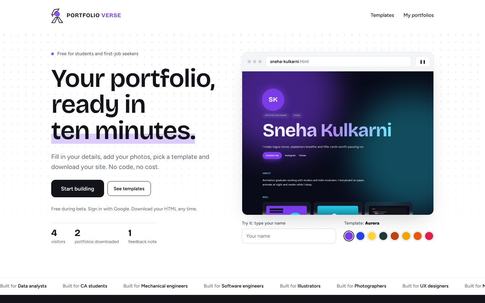
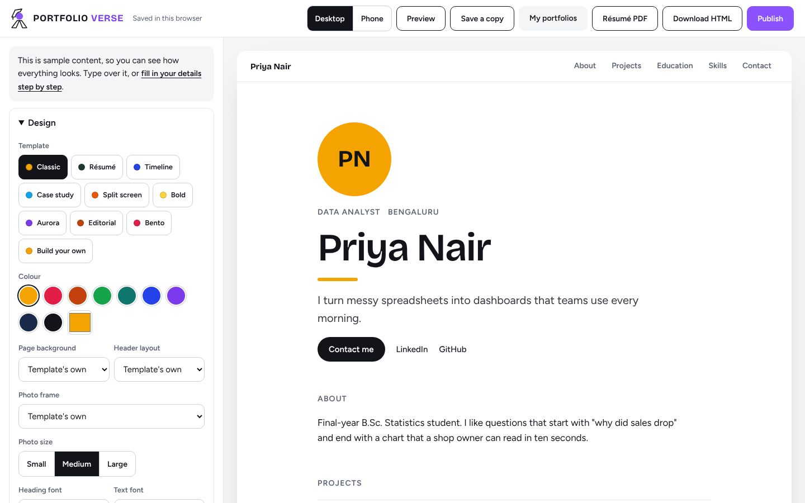
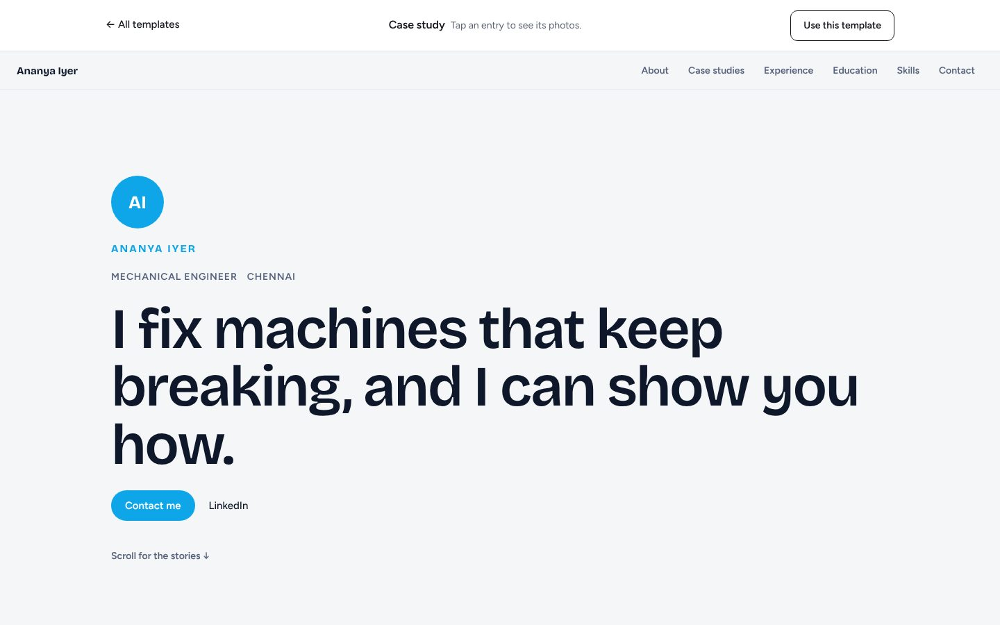

# PORTFOLIO-VERSE

[](https://github.com/aryannone/Portfolio-Verse/actions/workflows/ci.yml)

**A free portfolio website builder for students and first-job seekers.** Fill in your details (or import your résumé), pick one of nine templates, tweak the design, then download your whole site as a single HTML file or publish it with your own link. Sign in with Google, no code, no cost.

**Live:** [portfolio-verse-tau.vercel.app](https://portfolio-verse-tau.vercel.app)



## Why I built it

Most students need a portfolio site for internship and job applications, but website builders are either paid, lock your site into their platform, or produce generic pages. PORTFOLIO-VERSE:
- costs nothing
- keeps your portfolio in your own browser while you build it
- gives you the finished site as one file you own, or a live link in one click

## Features

- **9 templates, one data model, every screen size:** Classic, Résumé, Timeline, Case study, Split screen, Bold, Aurora, Editorial and Bento, plus "Build your own". Your details appear in every template, so you can switch at any time without retyping.
- **Live editor:**
  - colours, fonts, backgrounds, header layouts, photo frames and scroll animations, set for the whole page or per section
  - reorder sections and entries
  - desktop and phone preview
- **Google sign-in and profiles:** the home page, templates and feedback wall are open to everyone; building needs a Google account. Each person has a profile with their name, photo and a username for their site's link.
- **Publish:** one click puts the portfolio live at `portfolio-verse-tau.vercel.app/u/<username>`, full-page with nothing of the builder around it. One published site per person; publishing again replaces it, and it can be taken down any time.
- **One-file download:** the `.html` file holds the styles, photos and interactions, and works offline or on any host (GitHub Pages, Netlify, Vercel...). Downloaded and published sites end with a small "Made in • PORTFOLIO-VERSE" credit.
- **Résumé import:** reads a résumé PDF in the browser and fills in the details.
- **Résumé PDF export:** generates a clean résumé from the same details.
- **Photo background removal:** a person-segmentation model running in the browser cuts you out of your photo for the contact card.
- **Photos fit their frames:** an entry's photo shows whole, with a blurred copy of it filling the rest of the frame. A crop tool zooms in or out and moves it by dragging; any space it leaves is blurred too. Profile photos let you choose which part stays in view. Large photos are scaled down in the downloaded or published file, so sites stay small and publish fast.
- **Feedback wall:** signed-in visitors pick a sticky note, choose a topic and a handwriting style, sign it, and drag it onto a cork board on the home page. One note per Google account, editable from any device; notes appear for everyone once the owner approves them (an edited note is approved again). The owner can pin notes (a heart in the corner) and reply to them.
- **Admin page** (`/admin/feedback`, behind a secret key): approve, hide, pin, reply to or delete notes, approve all at once, search and sort.
- **Home page numbers:** unique visitors, portfolios downloaded and feedback notes, all counted for real. A browser counts once; a signed-in person counts once across all their devices.
- **Interactive contact section:** a 3D character that follows the pointer, watches visitors type and cheers when a message is sent; or your photo, a design, or nothing. The message form works through the visitor's email app or straight to your inbox.
- **Details panel:** visitors tap a project or job to open a side panel (a bottom sheet on phones) with the full story and photos.
- **Section navigation:** a sticky section bar, reading progress and back-to-top in every portfolio.
- **Many portfolios per browser:** autosave, rename, copy and delete. Details and designs are independent, so any details can go in any template.
- **Accessible:** keyboard-friendly, labelled controls, and every animation is turned off for people who ask for reduced motion.

| Template gallery | Editor |
| --- | --- |
|  |  |

| Case study template | On a phone |
| --- | --- |
|  |  |

## Tech stack

- **Next.js 15 (App Router), React 19, TypeScript**, deployed on **Vercel**
- **IndexedDB** for everyone's portfolios while they build, kept in their own browser
- **Supabase**: Auth (Google sign-in), Postgres (profiles, feedback, counters) and Storage (published sites)
- **MediaPipe Selfie Segmenter** (WebAssembly) for background removal
- **pdf.js** to read résumés, **jsPDF** to write them
- Hand-written CSS with custom properties and container queries; no UI library

## Engineering highlights

- **The builder runs on the device.**
  - Every builder feature, including machine-learning background removal and PDF parsing, runs in the browser. Portfolios are only sent to the server when their owner presses Publish.
  - The ML model and PDF engine are served by the site itself and loaded only when used (`scripts/copy-vendor.mjs`).
- **Small, locked-down server.**
  - Every table has row-level security on. The feedback, counter and visitor tables have no public policies at all: only the site's server, with the service role key, reaches them (`lib/supabaseRest.ts`). People can read and change only their own profile, and only its name and username.
  - Notes are checked with the same rules in the browser and on the server (`lib/feedback.ts`), and tied to the signed-in account (`app/api/feedback`).
  - `middleware.ts` keeps the sign-in session fresh and sends signed-out people from the building pages to `/signin`, then back.
- **Safe publishing.**
  - The browser uploads the HTML straight to a private Storage bucket, into a folder only its owner may write to (`supabase/sites.sql`), so large sites never pass through a serverless function.
  - `/u/<username>` serves the file with a `Content-Security-Policy: sandbox` header without `allow-same-origin` (`lib/publish.ts`). A published page runs as if on its own site, so its scripts can never read this site's cookies or anyone's sign-in session.
- **Honest numbers.** Each browser gets a random, anonymous id and is recorded once; signing in links it to the account, and the count is "signed-in people + browsers that never signed in" (`lib/visitors.ts`, `supabase/visitors.sql`).
- **One renderer, three places.**
  - `components/PortfolioView.tsx` renders every template from one markup tree.
  - The template's interactions (`lib/runtime.ts`) are written as a self-contained function. It runs in the editor and on preview pages, and is serialised into the downloaded and published HTML file (`lib/exportHtml.ts`), so the exported site behaves exactly like the preview.
- **Templates as styles, not code.** Each template is a set of CSS rules over shared markup (`public/portfolio.css`), so the editor's options combine with any template.
- **Safe, versioned storage.**
  - Portfolios are saved per id in IndexedDB with transactional updates (`lib/store.ts`).
  - Older saved data is migrated on load (`normalize` in `lib/portfolio.ts`), including templates that were merged or retired.
- **Résumé parsing without AI APIs.** `lib/resumeImport.ts` rebuilds lines from pdf.js text positions, finds section headings and pulls out names, links, dates and bullet points with patterns. The user always checks the result, and the UI says so.

## Lighthouse

Landing page, Lighthouse 12 (mobile, simulated throttling), median of three runs:

| Performance | Accessibility | Best practices | SEO |
| :---: | :---: | :---: | :---: |
| ~88 | 100 | 100 | 100 |

Performance is measured with the opening animation playing. It covers the page for about 3.5 seconds on every load, which Lighthouse counts as slow visual progress. With reduced motion (no intro), Performance is about 92 and Speed Index drops from about 3 s to 1.2 s.

Work done for these scores:
- accent colour deepened wherever it is small text, or sits behind small white text, to pass WCAG AA contrast
- correct heading order in the template gallery
- template styles minified at build time
- below-the-fold landing sections drawn only when near the screen (`content-visibility`), which halved main-thread work
- previews sized through `ResizeObserver` to avoid forced reflows

## Tests

Every push runs the [CI workflow](.github/workflows/ci.yml): type-check, unit tests, a production build and browser tests. The tests run without Supabase, so sign-in is off and server answers are simulated where needed.

- **Unit tests** (Vitest, `tests/unit`): link handling, file names, samples for every template, moving details between templates, upgrading portfolios saved by older versions, the feedback note rules, sign-in redirects, and publishing (the sandbox never shares this site's origin, safe usernames).
- **Browser tests** (Playwright, `tests/e2e`):
  - **Landing page:** the intro plays and can be skipped; every section appears on scroll; the four steps advance; the privacy page; the link preview image; the home page numbers.
  - **Feedback wall:** signed out, adding a note asks for Google sign-in; a note needs a name; it sticks by button or by dragging; one per account, even after a reload; editing a note; pinned notes and replies; the admin page's search, sort, pin, reply and approve all; the API without Supabase and the admin key check.
  - **Editor:** typing shows in the preview and survives a reload; the downloaded HTML file works on its own and ends with the credit line; photo format checks; a résumé PDF made by the site imports back; "Save a copy" adds a second portfolio; sample content cannot be published.
  - **Publishing:** an unpublished link shows a friendly page; the publish API needs a signed-in person.
  - **Sign-in:** the sign-in page offers Google and says what is shared; without Supabase every page stays open.

```bash
npm run typecheck
npm test            # unit tests
npm run build
npm run test:e2e    # browser tests (starts the built site)
```

## Project structure

```
app/          pages: landing, /start (details form), /templates, /editor, /saved, /profile, /signin,
              /privacy, /admin/feedback, /u/<username> (published sites)
              api/feedback (wall, own note, admin), api/publish, api/stats; auth/callback, auth/signout
components/   UI: PortfolioView (templates), Editor, PublishButton, Fields, StartForm, ContactBlock,
              FeedbackWall, FeedbackAdmin, SiteStats, UserMenu, GoogleSignIn, ProfileForm, MySite, Intro...
lib/          portfolio.ts (data model), store.ts (IndexedDB), runtime.ts (portfolio interactions),
              exportHtml.ts, publish.ts, feedback.ts, visitors.ts, supabaseRest.ts (server only),
              supabase/ (sign-in clients), resumeImport.ts, resumePdf.ts, cutout.ts, templates.ts, samples.ts
middleware.ts sign-in session and the signed-in-only pages
public/       portfolio.css (all template styles, also copied into exports), logo-mark.svg (the logo)
supabase/     SQL to set up the database (see below)
docs/         README screenshots
```

## Run it locally

Requires Node.js 18.18 or newer. The builder works with no settings: without them sign-in is off, every page is open, and the feedback wall, numbers and publishing show as not set up.

```bash
npm install
npm run dev
```

Open http://localhost:3000. `npm run build` makes a production build.

### Supabase and Vercel settings

| Variable | What it is |
| --- | --- |
| `NEXT_PUBLIC_SUPABASE_URL` | Supabase project URL, for Google sign-in in the browser (public) |
| `NEXT_PUBLIC_SUPABASE_PUBLISHABLE_KEY` | Supabase publishable key (public by design) |
| `SUPABASE_URL` | The same project URL, for the server |
| `SUPABASE_SERVICE_ROLE_KEY` | Supabase service role key: server only, never exposed to the browser |
| `FEEDBACK_ADMIN_KEY` | Any long secret you choose, at least 12 characters; opens `/admin/feedback` |

Set up the database once by running each file in `supabase/` in Supabase's SQL editor (each is safe to run again): `feedback.sql`, `site_stats.sql`, `profiles.sql`, `sites.sql`, `visitors.sql`.

Google sign-in also needs, in Supabase, **Authentication → Sign In / Providers → Google** turned on with a Google OAuth client, and **Authentication → URL Configuration** set to the site's address (Site URL, plus `https://<site>/**` as a redirect URL).

## Privacy

Portfolios are kept in the user's browser while they build; only a site they publish is stored on the server. Accounts hold the Google name, email and photo, plus the chosen name and username. There are no analytics services or tracking: visitors are counted with a random, anonymous id. Feedback notes are stored with the writer's account and shown publicly only after approval. See [/privacy](https://portfolio-verse-tau.vercel.app/privacy).
